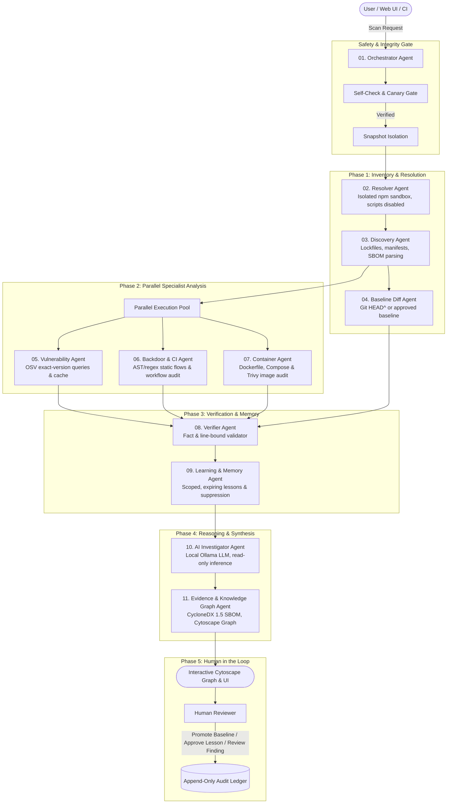
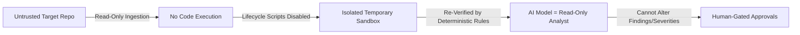

# GuardianAI: Agentic Security Workflow Architecture

GuardianAI operates as an **orchestrated multi-agent supply chain intelligence system**. It blends **deterministic specialist agents** with an **isolated, read-only AI investigation agent** and a strict **human-in-the-loop verification gate**.

---

## 1. High-Level Multi-Agent Architecture

---

## 2. Detailed Agent Roles & Responsibilities

| # | Agent Name | Module | Responsibility & Guarantees |
|---|---|---|---|
| **01** | **Orchestrator** | `engine.py` | Validates input bounds, sandboxes Git repositories (`core.hooksPath=/dev/null`, depth limits), schedules pipeline phases, and runs local canary tests. |
| **02** | **Resolver Agent** | `resolver.py` | Handles repos lacking committed lockfiles (e.g. OWASP Juice Shop). Resolves dependency trees in a disposable directory with `--ignore-scripts`, registry-only pinning, and marks results as *generated*. |
| **03** | **Discovery Agent** | `discovery.py`, `formats.py` | Parses lockfiles across Dart, npm, PyPI, Go, Cargo, Maven, Gradle, NuGet. Computes package coordinates (pURL), captures direct vs transitive relationships, and extracts exact lines. |
| **04** | **Baseline Diff Agent** | `detectors.py`, `history.py` | Compares current snapshot with `HEAD^` or a human-approved baseline. Detects added/removed/updated packages, file modifications, and critical checksum mismatches. |
| **05** | **Vulnerability Agent** | `osv.py` | Performs batch exact-version lookups against OSV.dev (CVE, GHSA). Caches responses in SQLite for 24h, extracts fixed boundaries, and scores CVSS. |
| **06** | **Backdoor & CI Agent** | `detectors.py`, `flow.py` | Static detectors for malicious source patterns: `curl \| sh`, unpinned GitHub Actions, `pull_request_target`, install hooks (`postinstall`), bidi overrides, obfuscated base64 execution, and bounded sensitive data exfiltration to outbound network sinks. |
| **07** | **Container Agent** | `containers.py` | Evaluates Dockerfile base images (floating tags vs digest pinning), privileged containers, root execution, socket mounts (`docker.sock`), and triggers optional local Trivy scans for OS layers. |
| **08** | **Verifier Agent** | `verifier.py` | **Defense against hallucinations and false positives.** Rechecks every finding against the immutable snapshot files, verifies line numbers, confirms exact package identities, and calculates confidence ratings. Rejects invalid signals. |
| **09** | **Learning & Memory Agent** | `store.py` | Applies human-approved, scoped, expiring suppression rules for confirmed false positives. **Enforces policy guardrails:** protected rules (e.g., integrity mismatch, secret exfiltration) can never be suppressed. |
| **10** | **AI Investigator Agent** | `ai.py` | Uses a local Ollama instance (Mistral/Llama) with strict boundaries: treated as untrusted data input, produces read-only hypotheses and recommended checks without the authority to alter severities, suppress findings, or approve baselines. |
| **11** | **Evidence & Graph Agent** | `engine.py`, `app.js` | Synthesizes findings into a CycloneDX 1.5 SBOM, generates BFS dependency paths from `app` to vulnerable nodes, builds the Cytoscape knowledge graph, and commits every decision to an append-only audit trail. |

---

## 3. Strict Determinism & Agent Safety Guardrails

GuardianAI adheres to five key design principles to prevent agentic hallucination or supply-chain execution attacks:

1. **Zero Execution of Target Code**:
   - `npm install --package-lock-only --ignore-scripts`
   - Git clones run with `core.hooksPath=/dev/null` and `--no-recurse-submodules`.
2. **AI Inference is Firewalled from Verified Evidence**:
   - The LLM receives finding summaries as untrusted data in an isolated prompt with strict negative instructions.
   - LLM responses cannot change CVSS scores, suppress findings, or invent package dependencies.
3. **Protected Guardrails in Learning Memory**:
   - Lessons allow suppressing false alarms after human review, but critical signals (integrity mismatches, raw token exfiltration) cannot be suppressed by any lesson.
4. **Independent Verifier Step**:
   - Findings produced by heuristic rules must pass the Verifier Agent, ensuring the referenced files, lines, and package identities actually exist in the raw repository snapshot.
5. **Full Traceability**:
   - Every single agent transition, verification rejection, lesson suppression, and human review is permanently stamped into the SQLite audit ledger with timestamps and cryptographic IDs.
