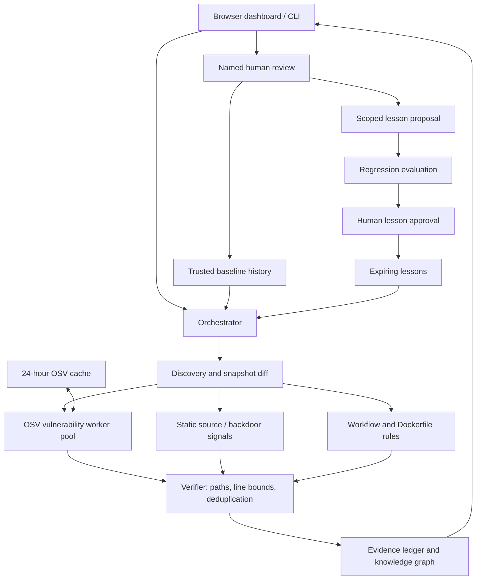

# Architecture

SQLite holds immutable scan payloads, versioned baseline approvals, review overlays, scoped lessons, expiring advisory cache, and an audit log. File snapshots store hashes and sizes, not full repository contents. Working memory consists of the bounded files, changes and worker results for the current run; a stage summary persists.

Knowledge graph nodes: application, exact package instances, findings/advisories, evidence files. Edges: `depends_on`, `declares`, `contains`, `affected_by`, `evidenced_by`. Each package instance has an inventory-file/installation-location suffix so multiple installed versions retain distinct dependency paths. Breadth-first traversal returns a shortest known root path without treating containment as proven dependency provenance.

Trust changes are explicit review endpoints or CLI commands. There is no model permission to approve or modify trust. Report evidence remains labeled as verified tool observations; heuristic interpretation is reflected in finding wording. The current verifier rechecks file existence and line bounds, not an independent second detector, so confidence remains Medium.

The server runs long scans in one background job at a time and supports progress polling. OSV work uses eight bounded concurrent requests. The browser renders SVG directly with no remote JavaScript or CDN dependency.
