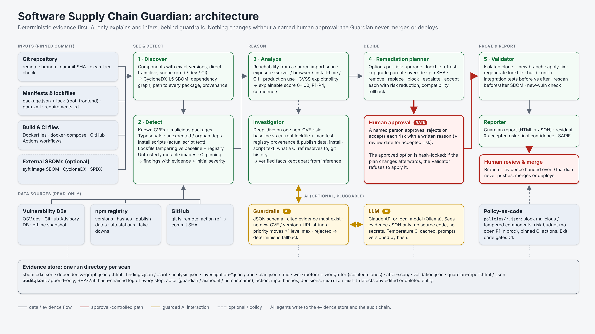

# Software Supply Chain Guardian

An agentic supply-chain security tool for the Bosch hackathon brief. It takes a repository from
**Discover → Detect → Analyze → Remediate → human approval → Validate → Report**. Deterministic
evidence comes first; AI only explains and infers, behind guardrails. Nothing changes without a
named human's approval, and the Guardian never pushes, merges or deploys.



- Architecture: [`docs/architecture.html`](docs/architecture.html) / `.png`
- Responsible AI and security note: [`docs/RESPONSIBLE_AI_AND_SECURITY.md`](docs/RESPONSIBLE_AI_AND_SECURITY.md)
- Prompts: [`prompts/`](prompts) · Sample policies: [`policies/`](policies) · Tests: [`tests/`](tests) (29, offline)

## Sample application
**OWASP Juice Shop**, fork `Geshna-B/juice-shop`, branch `hackathon-base`, commit `d6157d3a6`.
- Open source, containerised (Dockerfile + compose), with 16 GitHub Actions workflows.
- About 1,700 components across two lockfiles (root + `frontend/`).
- Built and tested locally: `npm ci`, `tsc`, 400+ server unit tests and 586 API integration tests.

## Setup
- Python 3.9+, no third-party Python packages.
- Node 22+ and npm, for building and testing the target app.
- Optional: Graphviz (`dot`) for SVG risk graphs, and `syft` for container-image SBOMs.

## Turn on the AI (pick one, then check it)
The Guardian uses an LLM in three roles: **Analyst** (explains each urgent finding), **Investigator**
(verdict on a non-CVE risk) and **Reporter** (executive summary). It picks the first backend it finds:

| Option | Cost | Setup |
|---|---|---|
| **Gemini** | free key (Google AI Studio) | `export GEMINI_API_KEY=...` (model: `GUARDIAN_LLM_MODEL`, default `gemini-3.8-flash`) |
| **Groq** | free key (console.groq.com) | `export GROQ_API_KEY=...` (default `llama-3.3-70b-versatile`) |
| **Claude** | paid key | `export ANTHROPIC_API_KEY=...` |
| **Ollama** (local) | free, nothing leaves the machine | `ollama pull llama3.1` then keep `ollama serve` running; auto-detected |
| any OpenAI-compatible | varies | `export OPENAI_BASE_URL=... OPENAI_API_KEY=...` |

```bash
python3 -m guardian ai-check     # shows the backend, sends a test finding, runs the guardrails
```
With no backend configured, everything still works and explanations come from deterministic templates.
The report and console always say which one was used (`[ai] gemini:... explained 15 findings, rejected 0`).
Without AI, the demo shows "deterministic": switch a backend on before presenting.

## End-to-end workflow (the live demo)
```bash
git clone -b hackathon-base https://github.com/Geshna-B/juice-shop
G="python3 -m guardian"

# 1-4  Discover, Detect, Analyze (+ investigate one non-CVE risk), Plan. Stops at the approval gate.
$G run juice-shop -o runs/js

#      Human decisions (a named person and a reason are mandatory)
$G approve runs/js --item R1  --option R1.a --by "Your Name" --reason "crypto-js critical, reachable via pdfkit"
$G approve runs/js --item R15 --option R15.a --by "Your Name" --reason "pin third-party action"
$G approve runs/js --item R2 --accept-risk --by "Your Name" --reason "intentional training vuln" --review-by 2026-12-31

# 5    Validate: isolated clone + branch, apply, build, unit + integration tests before vs after, rescan, SBOM diff
$G validate runs/js --setup "npm ci --ignore-scripts --legacy-peer-deps" --setup "npm rebuild sqlite3" \
   --before-setup "cd frontend && npm ci --ignore-scripts --legacy-peer-deps && npx ng build --configuration production" \
   --build "npm run build:server" --test "npm run test:server" --test "npm run test:api" \
   --reuse "frontend/dist:frontend" --npm-flags=--legacy-peer-deps

# Report, policy gate, audit
$G report runs/js            # runs/js/guardian-report.html + .json
$G gate runs/js --policy policies/default.json --after
$G audit runs/js             # verifies the hash-chained audit trail
```
Each stage can also run on its own: `scan`, `discover`, `analyze`, `investigate`, `plan`.

Planted-attack demo (8 attacks modelled on real incidents):
```bash
python3 tools/make_demo.py
$G run demo/compromised -o runs/demo --baseline demo/baseline/package-lock.json --verify-registry
```

## What each stage does

| Stage | Output | How |
|---|---|---|
| **1 Discover** | `sbom.cdx.json` (CycloneDX 1.5, schema-valid), `dependency-graph.json/.html/.dot`, `provenance.json` | Parses npm lockfiles v1–v3 using Node's real resolution, sub-projects, Maven (+ TGF tree), requirements.txt, Dockerfiles, compose files and Actions. Imports CycloneDX/SPDX. Records the commit and input-file hashes. |
| **2 Detect** | `findings.json` / `.sarif`, `report.html`, `risk-graph.svg` | Known CVEs and malicious packages (OSV.dev / GitHub Advisory DB; offline snapshot as fallback). Typosquats, unexpected/orphan dependencies, install scripts (reads the real script text), lockfile tampering against a baseline and the registry, untrusted/mutable/EOL images, CI/CD pinning and injection. |
| **3 Analyze** | `analysis.json` | Reachability from a source import scan (imported, parent-imported, test-only, unknown), exposure (server, browser, install-time, dev, CI, image), production use and CVSS exploitability. The result is an **explainable 0–100 score** with every factor listed, a P1–P4 priority, and a confidence level with reasons. Optional AI explanation, guarded. |
| **Investigate** | `investigation-*.json/.md` | One non-CVE risk. Verified facts: baseline diff, manifest, registry provenance and attestations, install-script text, what a CI ref resolves to via `git ls-remote`, and git history. AI or rule-based **inference is kept separate** and cites fact ids. |
| **4 Remediate** | `plan.json/.md` | Per risk: upgrade, lockfile refresh, upgrade parent (registry-checked), override, pin to SHA, remove, replace, block, escalate or accept. Each option states the risk reduction, the compatibility impact (semver delta, declared ranges, import sites) and the rollback. |
| **Approval** | `plan.json` + audit | A named human plus a reason. Accepted risk needs a review date. The option hash is locked at approval. |
| **5 Validate** | `validation.json`, `after-scan/`, `work/{before,after}` | Fresh clones and a new branch. Applies the change, regenerates lockfiles with `--ignore-scripts`, builds, and runs the same tests before and after. **Regression** means more failures, a newly failing test, or a worse exit code. Then: rescan, resolved / still present / **newly introduced** findings, before/after SBOM, production risk score and which tests exercise the changed code. |
| **Report** | `guardian-report.html/.json` | Inventory, paths, ranked findings with evidence, investigation, decisions, build/test results, before/after risk, residual and accepted risk, final confidence, and the audit trail with chain verification. |
| Policy gate | exit code | `policies/*.json`: block malicious or tampered components, a risk budget (e.g. no open P1 in production), pinned CI actions. |

## Results on Juice Shop (commit d6157d3a6)
See `examples/juice-shop/guardian-report.html`.
- **Inventory:** 1,692 components, 3,414 edges, depth 10.
- **Findings:** 89, identical to `npm audit` on the 52 package–advisory pairs.
- **Priorities:** 26 P1 and 22 P2 after context scoring. 680 source files were scanned for reachability; server exposure was taken from Dockerfile `EXPOSE 3000`.
- **Investigation:** `calibreapp/image-actions@main` runs whatever that branch points to; `git ls-remote` shows the commit it resolves to today.
- **Remediation validated:**
  - `crypto-js@3.3.0` (critical, reachable via `pdfkit` in `routes/order.ts`) was fixed by upgrading `pdfkit` 0.11 → 0.12.2.
  - The action was pinned to a commit SHA.
  - Both were verified by rescan, with build OK, no test regressions and no newly introduced vulnerabilities.
  - The JWT findings were *accepted* as intentional training vulnerabilities.

## Known limitations
- Reachability is package-level (imports), not function-level.
- Maven and Python transitive dependencies need `mvn` or a lock/SBOM.
- Container-image contents need syft or an imported SBOM. Image pulls were blocked in the sandbox used to build this.
- Juice Shop's server test runner reports a different total from run to run, so validation compares failures, not pass counts.
- Sandbox-only build workaround: Angular font inlining needs Google Fonts, so `tools/sandbox_no_font_inline.py` disables it in the *baseline build workspace only*. It is never committed to a fix branch.
- Item IDs (R1, R2…) depend on the current advisory data. Read `plan.md` before approving.
- The typosquat popular-name list is curated. The EOL image table is static (Nov 2026).

## Layout
```
guardian/discover/  guardian/detect/    stage 1-2
guardian/analyze/   context.py scoring.py ai.py investigate.py
guardian/remediate/ planner.py + approval      guardian/validate/  apply.py + validation
guardian/final_report.py  policy.py  audit.py  graph.py  graph_html.py  report.py  cli.py
prompts/  policies/  docs/  tools/  demo/  tests/  examples/
```
