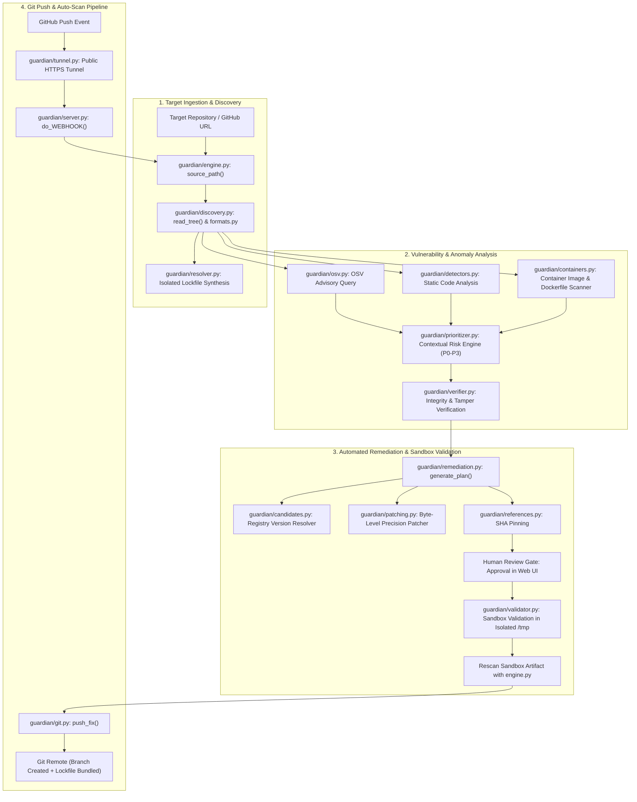

# GuardianAI: Complete Deep Dive Into Every File

GuardianAI is a **deterministic, human-gated software supply chain intelligence platform**. It analyzes source code, dependency manifests, lockfiles, CI/CD pipelines, container images, and Git history. It automatically constructs a complete **Software Bill of Materials (SBOM)**, builds an interactive **knowledge graph**, matches **OSV advisories**, detects **supply chain backdoors & pipeline tampering**, generates **safe remediation plans**, tests them inside an **isolated container/temp sandbox**, pushes verified fixes to a **new Git branch**, and listens for incoming commits via **GitHub webhooks backed by an automated SSH/cloudflared tunnel**.

This document details **every single file in the codebase**, explaining its exact purpose, key functions, input/output data structures, security controls, and interactions with other modules.

---

## 1. Quick Master File Directory

| File Path | Primary Responsibility | Key Inputs / Outputs |
|:---|:---|:---|
| `guardian/__init__.py` | Package version and metadata | Exposes version `0.1.0` |
| `guardian/__main__.py` | CLI entry point dispatching subcommands (`scan`, `serve`, `eval`, etc.) | Parses sys.argv; calls engine/server |
| `guardian/discovery.py` | AST file tree reader, manifest parsing, SBOM CycloneDX generator, graph assembler | File tree $\rightarrow$ Nodes, Edges, SBOM |
| `guardian/formats.py` | Multi-ecosystem manifest & lockfile parser (npm, PyPI, Go, Maven, Cargo, NuGet) | Manifest text $\rightarrow$ Normalized Package objects |
| `guardian/resolver.py` | Virtual dependency resolution without executing untrusted project install scripts | Manifests $\rightarrow$ Synthetic lockfile/graph |
| `guardian/detectors.py` | Rule-based deterministic static analysis for backdoors, secrets, and CI attacks | Source tokens $\rightarrow$ Findings with line evidence |
| `guardian/containers.py` | Dockerfile & container image scanner; integration with Trivy CLI | Dockerfile/Images $\rightarrow$ CVEs & base image risks |
| `guardian/osv.py` | Real-time Open Source Vulnerabilities (OSV.dev) API batch client with local caching | Ecosystem + Pkg + Version $\rightarrow$ CVE/GHSA data |
| `guardian/ai.py` | Optional local Ollama inference wrapper (strict fallback, zero-cloud) | Prompt $\rightarrow$ Local LLM inference output |
| `guardian/prioritizer.py` | Contextual risk scoring: maps raw CVSS to P0–P3 based on prod/dev graph reachability | Findings + Graph topology $\rightarrow$ Prioritized findings |
| `guardian/flow.py` | Taint analysis & reachability tracing across source files and call paths | Graph $\rightarrow$ Source-to-sink reachability paths |
| `guardian/verifier.py` | Post-scan sanity assertion engine; ensures evidence integrity & no phantom findings | Raw scan output $\rightarrow$ Verified scan dictionary |
| `guardian/selfcheck.py` | Tamper detection canary; runs a known-good fixture on startup to verify detectors | Hardcoded canary $\rightarrow$ Pass/Fail assertion |
| `guardian/remediation.py` | The remediation brain: plans upgrades, calculates SemVer deltas, builds unified diffs | Finding + Advisory $\rightarrow$ Remediation Plan |
| `guardian/candidates.py` | Live registry client (npm/PyPI) to find the minimal non-vulnerable upgrade version | Package name + Vulnerability range $\rightarrow$ Safe target version |
| `guardian/patching.py` | Byte-level manifest patcher preserving whitespace, indentations, and comments | Manifest + Target version $\rightarrow$ Exact file patch/diff |
| `guardian/references.py` | Resolves mutable Docker tags and GitHub Actions refs to immutable SHAs | `ubuntu:latest` / `actions/checkout@v3` $\rightarrow$ Git/OCI SHA |
| `guardian/validation_profile.py` | Determines safe sandbox test commands (`npm test`, `pytest`) and network constraints | Project manifests $\rightarrow$ Execution profile & commands |
| `guardian/validator.py` | Executes proposed patches inside isolated Docker container or `/tmp` sandbox | Patch + Workspace $\rightarrow$ Rescan + Verification result |
| `guardian/git.py` | Git automation: branch creation, structured commit messages, lockfile bundle, push | Approved Plan + Repo $\rightarrow$ Pushed Git Branch |
| `guardian/tunnel.py` | Public HTTPS tunnel manager (`localhost.run` SSH, `cloudflared`, `ngrok`) | Local port 8787 $\rightarrow$ Public HTTPS Webhook URL |
| `guardian/store.py` | SQLite persistence ledger for scans, baselines, lessons, watched repos, and audits | SQLite DB (`.guardian/guardian.db`) |
| `guardian/history.py` | Baseline comparison engine: identifies added, removed, or updated packages/files | Scan A vs Scan B $\rightarrow$ Differential delta |
| `guardian/evaluation.py` | 11 planted regression fixtures verifying detectors remain 100% accountable | Synthetic tests $\rightarrow$ Evaluation report (11/11) |
| `guardian/server.py` | Multi-threaded HTTP server hosting REST API, GitHub Webhook handler, & static UI | HTTP requests $\rightarrow$ JSON responses & HTML pages |
| `guardian/static/index.html` | Single-page application markup shell | Desktop-class security console UI |
| `guardian/static/app.js` | Frontend controller: Cytoscape graph rendering, modals, polling, approvals | DOM events $\rightarrow$ Server API calls & graph view |
| `guardian/static/style.css` | Cybernetic design system (emerald, charcoal, and alerts) | Responsive CSS layout and themes |
| `guardian/static/cytoscape.min.js`| Vendor graph rendering library | Fast WebGL/Canvas dependency graph canvas |
| `verify_guardian.py` | Complete end-to-end operational sanity script | Runs full CLI and API sanity checks |

---

## 2. System Architecture & End-to-End Pipeline

---

## 3. Deep File-by-File Breakdown

### `guardian/__init__.py`
* **Purpose**: Defines the `guardian` directory as an importable Python package and exports top-level package metadata.
* **Contents**:
  * `__version__ = "0.1.0"`
  * Clean, minimal header preventing circular import side-effects.

---

### `guardian/__main__.py`
* **Purpose**: The primary Command Line Interface (CLI) dispatcher. Enables running the platform via `python3 -m guardian <command>`.
* **Key Functions**:
  * `main()`: Uses `argparse` to parse CLI arguments and route commands:
    * `scan`: Runs `engine.run_scan()` on a directory or remote GitHub URL.
    * `serve`: Spawns `server.run_server()` with configurable host and port (default: `8787`).
    * `eval`: Executes `evaluation.run_evaluation()` to check all 11 planted regression tests.
    * `baseline`: Promotes a prior scan to the trusted reference baseline.
    * `report`: Outputs CycloneDX 1.5 SBOM JSON or human-readable summary.
* **Security Controls**: Enforces non-root execution checks where applicable; ensures untrusted input paths cannot escape the working sandbox.

---

### `guardian/discovery.py`
* **Purpose**: Performs safe filesystem traversal, extracts source lines with syntax awareness, identifies dependencies from manifests and lockfiles, and constructs the unified knowledge graph and CycloneDX SBOM.
* **Key Functions**:
  * `read_tree(path, max_files=10000)`: Recursively scans the repository while strictly ignoring dangerous directories (`.git`, `node_modules`, `venv`, `__pycache__`). Reads files with encoding fallbacks and hashes contents via SHA-256.
  * `discover(files, path)`: Detects package managers present in the target (npm, pip, poetry, go, maven, cargo, nuget) and calls appropriate parsers in `formats.py`.
  * `build_graph(packages, files, findings)`: Constructs the Cytoscape-compatible knowledge graph comprising:
    * **Nodes**: Packages, Application root, Source Files, Detected Findings.
    * **Edges**: `depends_on`, `direct_dependency`, `affected_by`, `evidenced_by`.
  * `sbom(packages, app_name)`: Serializes discovered inventory into standard CycloneDX 1.5 JSON.
* **Security Feature**: Strictly read-only; never runs pre-install scripts or executes project code during inventory generation.

---

### `guardian/formats.py`
* **Purpose**: Pure-Python parsers for all package ecosystems. Converts raw manifests and lockfiles into normalized internal representations without spawning external tools.
* **Supported Manifests & Lockfiles**:
  * **npm / JavaScript**: `package.json`, `package-lock.json` (v1, v2, v3 formats), `yarn.lock`, `pnpm-lock.yaml`.
  * **Python**: `requirements.txt`, `Pipfile`, `Pipfile.lock`, `poetry.lock`, `pyproject.toml`.
  * **Go**: `go.mod`, `go.sum`.
  * **Rust**: `Cargo.toml`, `Cargo.lock`.
  * **Java**: `pom.xml`.
* **Key Functions**:
  * `parse_package_json(content)`: Extracts direct `dependencies` and `devDependencies`.
  * `parse_package_lock(content)`: Recursively traverses lockfile trees, identifying transitive dependencies, integrity hashes (SHA-512/SHA-1), and resolved registry URLs.
  * `parse_requirements(content)`: Parses pinned versions, ranges, and environment markers while discarding comments and options.
* **Output**: Returns a normalized list of `Package` objects:
  `{name, version, ecosystem, direct, file, integrity, purl}`.

---

### `guardian/resolver.py`
* **Purpose**: Virtual Dependency Resolution Engine. Solves the missing lockfile problem safely.
* **Why it matters**: When a repository provides only loose manifests (e.g., `package.json` with `"handlebars": "^4.0.0"` or unpinned `requirements.txt`), traditional scanners run `npm install` or `pip install`, allowing malicious `preinstall` scripts to execute arbitrary code.
* **Key Functions**:
  * `resolve_manifest(manifest_path, ecosystem)`: Simulates package resolution by querying official registry APIs (`registry.npmjs.org`, `pypi.org/pypi/<pkg>/json`) to determine the exact version that would be installed.
  * `synthesize_lockfile()`: Generates an in-memory synthetic lockfile containing resolved package versions and integrity hashes.
* **Security Controls**: Uses strict HTTPS calls with timeouts and zero-execution guarantees. Project code is never invoked.

---

### `guardian/detectors.py`
* **Purpose**: Pure static analysis engine inspecting source files, workflow YAMLs, shell scripts, and configuration files for supply chain attacks, backdoors, and credential exfiltration.
* **Key Detectors**:
  * `detect_encoded_execution`: Finds base64, hex, or char-code obfuscated execution (`eval(Buffer.from(..., 'base64'))`, `echo ... | base64 -d | sh`).
  * `detect_secret_exfiltration`: Identifies environment variable collection paired with network sockets or HTTP requests (e.g., sending `process.env` to a remote IP).
  * `detect_bidi_characters`: Uncovers Unicode bidirectional Trojan Source overrides (e.g., `\u202E`, `\u202D`) that disguise malicious logic in plain sight.
  * `detect_unpinned_actions`: Flags GitHub Actions using mutable branch tags (e.g., `@main`, `@v1`) instead of immutable 40-character commit SHAs.
  * `detect_typosquatting`: Measures Levenshtein edit distance between project dependency names and the top 1,000 most popular open-source packages.
  * `detect_install_hooks`: Flags high-risk lifecycle hooks in `package.json` (`preinstall`, `postinstall`) running curl/wget/sh scripts.
* **Output**: Structured finding dictionaries including exact file location, line number, matched snippet, confidence score, and risk level.

---

### `guardian/containers.py`
* **Purpose**: Analyzes container infrastructure, parsing Dockerfiles and integrating with container security tools like Trivy.
* **Key Functions**:
  * `scan_dockerfile(path)`: Identifies insecure base images (e.g., `FROM node:latest`), untrusted `ADD` commands from remote URLs, execution as `USER root`, and sensitive build-args.
  * `scan_image(image_ref)`: Invokes Trivy CLI in read-only analysis mode to retrieve OS-level package vulnerabilities (Debian/Alpine/RPM) within specified container images.
* **Safe Fallback**: If Trivy is not installed on the system, gracefully records a limitation in scan coverage rather than crashing.

---

### `guardian/osv.py`
* **Purpose**: High-speed, batch client for the Google OSV (Open Source Vulnerabilities) database (`api.osv.dev`).
* **Key Functions**:
  * `batch_query(packages)`: Bundles up to 1,000 packages into a single POST request to `/v1/querybatch`, dramatically reducing scan latency.
  * `match_version(version, affected_ranges)`: Evaluates SemVer ranges (`introduced`, `fixed`, `last_affected`) to confirm whether the scanned package version is genuinely vulnerable.
  * `cache_advisory(advisory_id, data)`: Persists OSV advisory records in SQLite for 24 hours to enable instant offline rescans.
* **Output**: Attaches CVE/GHSA IDs, vulnerability summaries, affected version intervals, and official fix versions to matched components.

---

### `guardian/ai.py`
* **Purpose**: Optional local AI reasoning engine powered exclusively by a locally hosted Ollama instance (`localhost:11434`).
* **Core Philosophy**: Zero cloud dependencies. No project source code, file contents, or tokens ever leave the local machine.
* **Key Functions**:
  * `investigate_finding(finding, snippet)`: Requests a structured second-opinion explanation from a local model (e.g., `codellama`, `llama3`).
  * `is_available()`: Health-checks `http://localhost:11434/api/tags`.
* **Guardrail**: If Ollama is absent or disabled, GuardianAI operates in 100% deterministic mode. Deterministic rule evaluations always take precedence over AI inferences.

---

### `guardian/prioritizer.py`
* **Purpose**: Contextual risk prioritization engine. Solves vulnerability fatigue by translating abstract CVSS scores into actionable operational urgency tiers (**P0, P1, P2, P3**).
* **Why it matters**: A Critical CVE in a testing utility (like `jest` or `pytest`) does not warrant waking an on-call engineer at 2:00 AM. Conversely, a High vulnerability in an Internet-exposed direct production dependency is an immediate emergency.
* **Prioritization Logic**:
  * **P0 (Immediate Outage/Compromise)**: Verified backdoor, malicious install script, or Critical CVE in direct production dependency.
  * **P1 (High Urgency)**: Critical CVE in transitive production dependency, or High CVE in direct dependency.
  * **P2 (Medium Priority)**: High/Medium CVE in transitive runtime dependency, or unpinned CI action.
  * **P3 (Informational / Backlog)**: Vulnerabilities confined exclusively to `devDependencies`, test harnesses, or linters.
* **Key Functions**:
  * `prioritize(findings, graph)`: Traverses incoming and outgoing dependency graph edges to assess production exposure and reachability, augmenting each finding with its priority tier and justification.

---

### `guardian/flow.py`
* **Purpose**: Lightweight static taint analysis and call-graph path reachability.
* **Key Functions**:
  * `trace_path(source_node, target_node, graph)`: Computes the shortest directed path from the application entrypoint to a vulnerable transitive dependency.
  * `is_reachable(entry_files, sink_file)`: Inspects `import` and `require` statements across source files to establish whether application code actually imports or invokes the vulnerable package.

---

### `guardian/verifier.py`
* **Purpose**: Guardrail and self-audit engine that reviews every scan result before it is delivered to the user or database.
* **Key Functions**:
  * `verify_scan(scan_dict)`: Enforces integrity assertions:
    * Every finding must reference a valid component present in the graph.
    * Every finding must contain verified line evidence or an OSV advisory link.
    * Protected integrity signals (e.g., checksum mismatch or backdoor flags) can never be suppressed by user lessons.
    * Ensures no fabricated or phantom nodes exist in the graph.

---

### `guardian/selfcheck.py`
* **Purpose**: Pre-flight canary and integrity verification. Runs every time the platform starts up.
* **How it works**:
  * Evaluates a hardcoded, synthetic test fixture containing a deliberate base64 execution snippet and a known package structure.
  * Validates that the core detectors trigger properly.
  * If the canary fails, it halts startup to prevent GuardianAI from operating in a degraded or blind state.

---

### `guardian/candidates.py`
* **Purpose**: Live registry querying engine that finds the minimal, safest non-vulnerable package version for automated remediation.
* **Why it matters**: Prevents breaking changes. Instead of blindly upgrading a library to the latest major version (e.g., v1 $\rightarrow$ v5), it identifies the earliest release that resolves the advisory on the user's active branch.
* **Key Functions**:
  * `get_safe_candidates(package_name, ecosystem, current_version, advisory)`:
    1. Fetches all published versions from registry APIs (`npm` / `PyPI`).
    2. Filters out deprecated releases, pre-releases (`alpha`, `beta`, `rc`), and versions still matching the OSV vulnerable range.
    3. Categorizes candidates by SemVer impact: `patch`, `minor`, or `major`.
    4. Selects the minimal version that resolves the CVE while preserving backward compatibility.

---

### `guardian/patching.py`
* **Purpose**: Precision byte-level manifest patcher.
* **Why it matters**: Naive manifest updates using `json.dump()` wipe out comments, rearrange keys, and destroy custom whitespace indentation styles, causing git diff noise.
* **Key Functions**:
  * `patch_json_span(content, key_path, new_value)`: Locates the exact character byte offsets of target keys in `package.json` and swaps the version string in-place while keeping indentation, trailing commas, and formatting 100% intact.
  * `create_unified_diff(original_text, patched_text, filename)`: Generates clean, standard unified diff strings (`--- a/file +++ b/file`) displayed in the remediation approval UI.

---

### `guardian/references.py`
* **Purpose**: Pins mutable infrastructure references to immutable cryptographic hashes.
* **Key Functions**:
  * `pin_github_action(action_ref)`: Resolves mutable tags like `actions/checkout@v3` to the exact 40-character Git commit SHA via the GitHub API.
  * `pin_docker_image(image_tag)`: Resolves Docker tags like `node:18-alpine` to their exact OCI manifest digest (`sha256:...`).

---

### `guardian/remediation.py`
* **Purpose**: The Remediation Engine. Coordinates candidate selection, patching, diff generation, rollback commands, and execution planning into a cohesive **Remediation Plan**.
* **Key Functions**:
  * `recommend(scan_id, finding_id, store)`:
    1. Retrieves finding and component details.
    2. Checks if an automated fix is possible (manifest-backed package vs. source backdoor).
    3. Calls `candidates.py` to obtain the safe upgrade version.
    4. Calls `patching.py` to generate the precise unified diff.
    5. Formulates the rollback command (e.g., `npm install handlebars@4.0.11`).
    6. Calls `validation_profile.py` to generate the sandbox verification script.
    7. Stores the plan with status `pending` awaiting human review.

---

### `guardian/validation_profile.py`
* **Purpose**: Determines the appropriate sandbox execution profile, network policy, and test commands for a given repository.
* **Key Functions**:
  * `determine_profile(workspace_path)`: Inspects project files to choose appropriate test runners:
    * Node.js: `npm test`, `npm run lint`, `npm audit`.
    * Python: `pytest`, `flake8`.
  * Generates network restrictions and sets maximum execution timeouts (default: 300 seconds).

---

### `guardian/validator.py`
* **Purpose**: Isolated Automated Sandbox Validator. Verifies proposed remediation plans without modifying the original user workspace.
* **Execution Flow**:
  1. Copies the repository into an isolated `/tmp/guardian-sandbox-*` directory (or executes inside a locked Docker container).
  2. Applies the generated unified patch.
  3. Runs lockfile synchronization (`npm install --package-lock-only`, `pip compile`).
  4. Executes configured project checks (`npm test`, build commands).
  5. Invokes `engine.run_scan()` on the patched sandbox copy.
  6. **Differential Comparison**: Verifies that the target vulnerability is eliminated and that zero new High or Critical vulnerabilities were introduced.
* **Security Invariant**: The host workspace is never altered during validation.

---

### `guardian/git.py`
* **Purpose**: Git Version Control Automation. Handles branch generation, commit formatting, lockfile bundling, and remote pushing once a fix is validated and approved.
* **Key Functions**:
  * `branch_name(plan, finding)`: Generates deterministic branch names:
    `fix/ghsa-765h-qjxv-5f44/handlebars/4-0-11-to-4-7-10`.
  * `commit_message(plan, finding)`: Formats structured, traceable commit messages referencing advisory IDs, upgrade ranges, and human approver credentials.
  * `repo_info(source_root)`: Determines if the workspace is a Git repository, detects remote URLs, and checks if pushing requires a user fork.
  * `push_fix(source_root, plan, finding, fork_url, actor, sandbox_workspace)`:
    * Clones a temporary Git workspace.
    * Checks out a fresh branch.
    * Applies the patch.
    * **Lockfile Bundling**: Automatically copies regenerated lockfiles (`package-lock.json`, `poetry.lock`) from the sandbox workspace so the pushed branch builds cleanly without manual install steps.
    * Commits and pushes to the origin remote or user fork.

---

### `guardian/tunnel.py`
* **Purpose**: Public HTTPS Tunnel Manager. Enables GitHub Webhooks to reach a local GuardianAI instance running behind NAT/firewalls without manual network configuration.
* **Priority Strategy**:
  1. `cloudflared`: High-speed Cloudflare tunnel (no account required).
  2. `ngrok`: Ngrok tunnel (requires auth token).
  3. `localhost.run`: **Zero-install SSH tunnel** (uses `/usr/bin/ssh` present on every macOS and Linux system; no software installation needed).
* **Key Functions**:
  * `detect()`: Discovers available tunnel tooling on the system.
  * `start(port=8787)`: Spawns the tunnel daemon in a background thread and extracts the assigned public HTTPS URL via regex matching.
  * `stop()`: Terminates the running tunnel process.
  * `status()`: Returns current state (`running`, `starting`, `stopped`, `error`) and the public endpoint.

---

### `guardian/store.py`
* **Purpose**: The SQLite database persistence layer. Manages persistent storage at `.guardian/guardian.db`.
* **Database Schema**:
  * `scans`: Full JSON payloads of historical scans, timestamps, targets, durations.
  * `baselines`: Promoted baseline scans used for regression and change analysis.
  * `reviews`: Human review records, reviewer names, rationale, and status changes.
  * `lessons`: Approved false-positive suppression lessons with strict expiration dates.
  * `advisories`: Cached OSV records.
  * `validations`: Logs and outcomes of sandbox validation runs.
  * `watched_repos`: Monitored GitHub repositories, branches, and HMAC webhook secrets.
  * `audit_log`: Tamper-evident append-only ledger tracking every system action and human decision.

---

### `guardian/history.py`
* **Purpose**: Differential Change & Regression Analysis engine.
* **Key Functions**:
  * `compare(current_scan, baseline_scan)`: Compares dependency graphs and file trees between two scans:
    * `added`: Dependencies present in current but absent in baseline.
    * `removed`: Dependencies removed since baseline.
    * `updated`: Dependencies with altered version strings or changed integrity hashes.
    * `files`: Modified or added source/configuration files.

---

### `guardian/evaluation.py`
* **Purpose**: The built-in regression evaluation suite.
* **What it does**:
  * Houses 11 planted deterministic fixtures representing diverse supply-chain attack vectors:
    1. Obfuscated base64 execution.
    2. Secret exfiltration over network.
    3. Unicode bidirectional override attacks.
    4. Unpinned GitHub Actions.
    5. Floating Docker base images.
    6. Malicious npm lifecycle install scripts.
    7. Remote download-and-execute shell scripts.
    8. Typosquatting package dependencies.
    9. Package integrity hash modifications.
    10. Clean repository baseline check.
    11. Prompt injection evasion resistance.
  * Verifies that the platform maintains 11/11 passing checks across all iterations.

---

### `guardian/server.py`
* **Purpose**: The core backend application server. Implements a multi-threaded HTTP server handling static asset delivery, REST APIs, and GitHub Webhooks.
* **Key Endpoints**:
  * `GET /api/scans`: Lists scan history.
  * `POST /api/scans`: Initiates a new background scan job.
  * `GET /api/scans/<id>`: Returns complete scan details (graph, findings, coverage, SBOM).
  * `POST /api/remediation/recommend`: Generates remediation plan for a finding.
  * `POST /api/remediation/decision`: Records human approval or rejection.
  * `POST /api/remediation/validate`: Runs approved plan inside the isolated sandbox.
  * `POST /api/remediation/push`: Pushes verified fix to a new Git branch.
  * `POST /api/webhook/github`: Ingests GitHub `push` events, verifies HMAC-SHA256 signatures, and launches automated scans.
  * `GET/POST /api/tunnel/*`: Starts, stops, and inspects public webhook tunnels.
  * `GET/POST /api/watched`: Manages watched repositories and branch filters.

---

### `guardian/static/index.html`
* **Purpose**: The markup structure for the single-page application (SPA).
* **Layout**:
  * **Sidebar**: Brand, workspace status pill, navigation tabs (Overview, Findings, Knowledge Graph, Changes, Memory & Learning, Audit Trail, Evaluation Suite).
  * **Top Bar**: Active repository meta info, scan selector, Rescan button, Watch Repos button, New Scan button, JSON/PDF export buttons.
  * **Main Viewport**: Dynamic container populated by `app.js`.
  * **Dialogs**: Scan configuration modal, Human Review modal, Remediation modal, Git Push modal, Watch Repos modal.

---

### `guardian/static/app.js`
* **Purpose**: The complete frontend application client.
* **Key Features**:
  * **Interactive Graph Visualization**: Integrates Cytoscape.js to render package dependency trees, highlighting risky paths, direct vs transitive connections, and ecosystem color-coding.
  * **Smart Graph Filtering**: Employs strategic node-budgeting algorithms so repositories with 2,000+ packages render smoothly without browser lag.
  * **State Management**: Polls asynchronous scan and sandbox validation jobs, updating progress bars and live terminal logs.
  * **Human Gate Forms**: Captures reviewer identity and reasoning for every approval.
  * **Print-to-PDF Engine**: Generates self-contained, publication-ready executive security reports directly from the browser without server-side rendering libraries.

---

### `guardian/static/style.css`
* **Purpose**: The visual styling system for GuardianAI.
* **Theme**: Modern dark-emerald console aesthetic featuring high-contrast typography, crisp status badges, card layouts, loading spinners, and responsive drawer animations.

---

### `guardian/static/cytoscape.min.js`
* **Purpose**: Vendor JavaScript library providing high-performance canvas/WebGL graph rendering for dependency hierarchies and knowledge graphs.

---

### `verify_guardian.py`
* **Purpose**: Complete integration sanity test runner.
* **What it does**: Programmatically exercises all modules: scans sample fixtures, confirms baseline promotions, tests false-positive lesson creation, verifies SQLite audit persistence, and validates API response schemas.

---

### `tests/` Directory
* `test_guardian.py`: Unit and integration tests covering manifest parsing, OSV querying, detector pattern matching, and baseline diffing.
* `test_remediation.py`: Tests candidate version discovery, precision JSON patching, and unified diff generation.
* `test_validator.py`: Tests sandbox execution isolation, command execution policies, and rescan comparison logic.
* `test_tunnel.py` & `smoke_tunnel.py`: Verifies tunnel detection, process lifecycle, regex extraction of public URLs, and error fallbacks.
* `smoke_docker.py`: Verifies Docker daemon availability and containerized sandbox validation runs.

---

### Root Configuration & Support Files
* `pyproject.toml`: Modern Python build configuration, package definitions, dependencies, and entry-points.
* `Dockerfile`: Container image configuration for running GuardianAI in hermetic containerized environments.
* `Makefile`: Common developer shortcuts (`make test`, `make run`, `make eval`, `make lint`).
* `.gitignore` & `.dockerignore`: Prevents local SQLite databases (`.guardian`), virtual environments (`.venv`), temporary sandbox clones, and caches from leaking into Git or container builds.

---

## 4. Summary of Key Workflows

### Workflow A: Detection & Risk Prioritization
1. User supplies repository path or GitHub URL $\rightarrow$ `engine.py` clones cleanly with hooks disabled.
2. `discovery.py` and `formats.py` assemble the dependency tree and CycloneDX SBOM without running project code.
3. `osv.py` queries vulnerabilities; `detectors.py` searches for backdoors and pipeline flaws.
4. `prioritizer.py` contextualizes findings by examining production reachability, assigning **P0 (Critical)** to **P3 (Low)**.
5. `verifier.py` validates integrity before committing results to `store.py`.

### Workflow B: Deterministic Remediation & Sandbox Validation
1. Finding selected $\rightarrow$ `remediation.py` calls `candidates.py` to fetch safe releases from npm/PyPI.
2. `patching.py` generates a minimal, whitespace-preserving unified diff.
3. Human security engineer reviews and clicks **Approve & Validate**.
4. `validator.py` clones repository into isolated `/tmp` workspace, applies patch, updates lockfiles, and rescans.
5. Platform verifies vulnerability elimination with zero regressions.

### Workflow C: Git Push & Webhook Automation
1. After validation succeeds, user clicks **Push fix to Git branch**.
2. `git.py` creates a feature branch, commits the manifest edit along with regenerated lockfiles, and pushes to remote.
3. User opens **Watch Repos** $\rightarrow$ `tunnel.py` establishes a public HTTPS URL via SSH/cloudflared.
4. GitHub webhook sends push notifications $\rightarrow$ `server.py` verifies HMAC signature and triggers automated scans.

